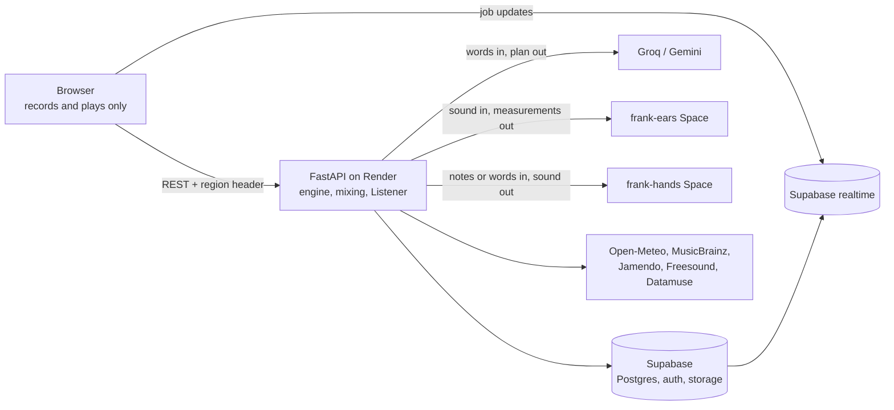

# Frank

> You have the song. Frank handles the rest. **Use Frank.**

Frank is a web-based music production studio for people who have music inside them but no music knowledge, no
instruments and no money for a producer. It is not a song generator: you and Frank work on the song together,
version by version, until it sounds like the one in your head, with your voice and your words.

**Live:** https://frank-bay-zeta.vercel.app (the free server sleeps after 15 quiet minutes; the first visit
says "Frank is waking up" for up to a minute).

---

## What it does

Start with anything: type how it should feel, paste your words, hum or sing a tune, say it out loud, tap a
rhythm, share a picture, or start from this moment (your time of day and weather). Frank works out what it got
and keeps going from there. Six rooms, always open, never locked:

| Room | What happens |
|---|---|
| **Words** | Write the words with a co-writer that offers options and never rewrites yours. It shows how many beats each line has, which syllables are strong, which lines rhyme, and the feeling of each section |
| **Feeling** | Find the feeling through short sounds and conversation. Hum or tap to show it, or conduct with your hands in front of the camera |
| **Music** | Frank's own music engine builds the beat (around your hum, if you gave one), with real drummers' feel, chords shaped by real songs, and recorded piano and strings. Change any part of any section in plain words, or ask for a new part written around your tune |
| **Voice** | Sing along with the tune, or with a guide voice that sings your words. Frank lines takes up with the beat, tunes them to *your song's* notes, takes out room noise or the beat that leaked into the mic, builds the best version line by line, adds a harmony that follows the chords, and can play your hum as a violin |
| **Blend** | Every part of the music mixed separately; "the piano's too loud in the bridge" just works. Add a real recorded atmosphere such as rain or a city at night |
| **Finish** | Frank asks if it matches what you first described and finishes it to streaming loudness, or to match a song you point at. Download the song, its separate parts, or its notes for any music app, with the credits it needs |

Anywhere: **"Something feels off"** makes Frank listen properly, say what it measured, and offer two or three
directions you can hear before choosing. "Give me the second version back" works. Nothing is ever overwritten.
Frank learns your taste over several songs (you can see, edit or forget it) and protects what makes each song yours.

---

## How it is built

| Part | Technology |
|---|---|
| Frontend | Next.js 14, React 18, TypeScript, Tailwind, shadcn/ui, Zustand. Records and plays audio only; it never processes it |
| Backend | Python 3.12, FastAPI, Supabase (Postgres with row level security, auth, storage) |
| Music | Frank's own procedural engine: chords, bass, tune and drums composed in code from the song's feeling, played by FluidSynth with the MuseScore General SoundFont (MIT) |
| Audio | FFmpeg, librosa (`pyin` for pitch), Rubber Band (`pylibrb`), pedalboard |
| Listening | Frank's Listener: loudness (BS.1770), section lift, repetition, voice-vs-music, timing, tuning, noise, all measured, never guessed |
| Language | Groq `openai/gpt-oss-120b` (Gemini `gemini-flash-latest` when Groq fails), Whisper on Groq; every reply checked for music jargon in code |
| Outside help | Two free Hugging Face ZeroGPU Spaces: **frank-ears** (CLAP, Essentia, Audiobox Aesthetics, chords, structure, separation, matched master, noise removal, GoEmotions) and **frank-hands** (Anticipatory Music Transformer, Kokoro voice, DDSP, DiffSinger guide voice, Stable Audio atmosphere). Gemini listens and looks where its free tier is allowed. Mined data from Groove MIDI, Chordonomicon, Lakh MIDI and Song Describer. Every part and its licence: [THIRD_PARTY.md](THIRD_PARTY.md) |
| Hosting | Vercel (frontend), Render Docker web service (backend, 512 MB), Supabase, Hugging Face Spaces. All free tier |



If a Space or an outside service is asleep or out of free quota, the feature says so plainly and Frank carries on
with its own engine and measurements.

Why no MusicGen: there is no free hosted path any more, and a procedural engine is controllable ("the bass is too
busy" changes the bass, not the whole song). See `.kiro/steering/tech.md`.

---

## Run it locally

Prerequisites: Node 18+, Python 3.11+, FFmpeg, FluidSynth and Rubber Band
(`sudo apt install ffmpeg fluidsynth libfluidsynth3 librubberband2`), a Supabase project and a Groq key.

```bash
git clone https://github.com/Udeibom/frank && cd frank
cd frontend && npm install && cp .env.local.example .env.local && cd ..
cd backend && python3 -m venv venv && venv/bin/pip install -r requirements.txt -r requirements-dev.txt
cp .env.example .env && bash scripts/fetch_soundfont.sh && cd ..
```

Fill in `frontend/.env.local` and `backend/.env`, then run every file in `backend/db/migrations/` in order in the
Supabase SQL editor (they are additive and safe to re-run). Start both servers:

```bash
cd backend && venv/bin/uvicorn app.main:app --reload --port 8000     # API docs at /docs
cd frontend && npm run dev                                            # http://localhost:3000
```

Tests: `cd backend && venv/bin/python -m pytest -q tests` (505 tests, 252 of them property tests) and
`cd frontend && npx tsc --noEmit && npm test` (vitest with fast-check). `backend/scripts/mutate_check.py` breaks the code on purpose to prove the
property tests can fail.

## Deploy

- Backend: Render **Docker** web service from `backend/Dockerfile` (it installs FluidSynth/FFmpeg/Rubber Band
  and fetches the SoundFont). `render.yaml` describes it; pushes to `main` deploy it.
- Frontend: `cd frontend && vercel deploy --prod`.
- Set the environment variables listed in `.kiro/steering/deployment.md`; `ALLOWED_ORIGINS` is the Vercel URL.
- Checks against the live site: `backend/scripts/ops/e2e.py` (full walkthrough), `demo_runs.py` (the three demo
  stories, recorded in `docs/demo-runs/`), `rls_check.py` (two users cannot see each other's songs or taste).

CI (`.github/workflows/ci.yml`) runs the backend tests with the server's audio libraries, the frontend type check
and build, and the spec and architecture checkers on every push.

## How Kiro was used

See [KIRO_USAGE.md](KIRO_USAGE.md): specs before code (`.kiro/specs`, `_roadmap.md` is the index), steering, and the
runtime team as a Skill (`.kiro/skills/frank-team/SKILL.md` is checked against the role cards by a test), hooks that run real
checks, Skills, custom agents including a Producer that runs the others in order, four MCP servers including
Frank's own Listener (also packaged as a Power), a nightly listening regression for Kiro Crew, and property tests
proved able to fail.

Licence: MIT for Frank's own code (`LICENSE`). Models, datasets and tools keep their own licences, and some are
non-commercial: see [THIRD_PARTY.md](THIRD_PARTY.md). Built with [Kiro](https://kiro.dev) for Kiroween 2026.
