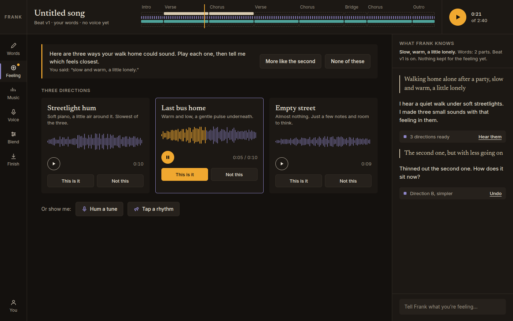

# Frank: Design Audit and Art Direction (revision 2)

Status: **proposal, awaiting approval. No application code has been changed.**
This revision replaces my first version. The first one skipped the research the brief asked for, inspected too little, and built its art direction on memory. This one is organised around what the brief asked for, and ends with a checklist of what I did and did not do.

Files: before-screenshots in `docs/design-audit/before/` (numbers below, e.g. **#15**), a direction mock in `docs/design-audit/proposal/feeling-room-mock.html` (+ `.png`).

---

## 0. How this was done, and its limits

**Inspected in the running app** (Next dev server + FastAPI backend, fresh account, 1440×900 unless stated):
landing, sign-up, song list (#00–#02, #11); Idea Room empty, with the first-run drawer, and with lyrics (#03, #04, #18); Feel Lab empty, mid-conversation, with a texture playing (#05–#07); Beat Room empty, building, failed, and populated with a built beat (#12–#16); Beat Room at 1024px (#17); Voice, Mix, Export in their empty states (#08–#10).
**Measured in the browser:** whether two audios can play at once, tab stops before main content, landmarks, smallest rendered font size, resolved font family.
**Read in source:** app shell and all six room pages, the conversation panel, nav, song summary, timeline, take card, stem balance, vocal recorder, stores, audio code, global styles and Tailwind config.

**Not seen in a browser:** Voice with recorded takes, Mix with a rendered mix, Export with a finished song. These need a recorded vocal, and the automation browser cannot supply a microphone. Findings about them come from source and are marked **(source)**. Before implementation I will set up a test vocal so these states can be captured honestly.

**Side effect:** I created `design-audit@example.com` and one song in your Supabase project. Say if you want them removed.

---

## 1. Research: what real tools do, and what Frank should and should not take

I read these sources this round. Two things limit them: several pages timed out when I fetched them (the Ableton Learning Music site, Descript's help page, one Suno comparison), so for those I rely on search-result summaries and say so; and the Suno/Udio and Teenage Engineering sources are third-party write-ups, not my own use of the products. I did not use any of these apps hands-on in this session. I have **not** studied GarageBand, Logic, Soundtrap (beyond one snippet), Bitwig, Moises or Endlesss this round, so they are not in the table.

| Product | What the source says | Principle for Frank | What not to copy |
|---|---|---|---|
| **Ableton Live**: [Live Concepts](https://www.ableton.com/en/manual/live-concepts/), [Arrangement View](https://www.ableton.com/en/manual/arrangement-view/) | One Control Bar holds transport, tempo, arrangement position and a toggle between Session and Arrangement views; a Status Bar explains what is under the cursor. The Arrangement has an **Overview** of the whole song that doubles as navigation, a scrub area that starts playback from where you click, and **locators** that turn a piece into launchable sections. Session View (improvise, loop, launch) and Arrangement View (linear structure) are two views of the same set. | (1) Transport and position live in **one persistent bar**, not per screen. (2) Different rooms can be **different views of one underlying song**. (3) A whole-song overview that you navigate by clicking sections. (4) A line that explains what you are pointing at. | Bars/beats/16ths, the density of controls, the mixer-as-faders metaphor |
| **BandLab Mix Editor**: [blog](https://blog.bandlab.com/the-new-bandlab-mix-editor/) | The timeline is present on **every** screen of the editor, including mix and single-track views; song length is shown in minutes and seconds as well as bars and beats; sessions auto-save and restore; the team built a shared **conceptual model** of the whole editor before simplifying it. | A timeline that survives every view; plain time (minutes and seconds) for people who do not read bars; autosave you can see; **define Frank's conceptual model before drawing screens** (section 3.1). | Track-stack layout, social feed, mobile-first density |
| **Descript**: [help](https://help.descript.com/hc/en-us/articles/15726742913933-Edit-like-a-doc), [editor map](https://www.descriptmastery.com/blog/transcript-scene-editor-and-timeline-descript-editor-map) | You edit audio by editing the transcript; media follows. The editor has three regions (transcript, preview, timeline); beginners start in the transcript and use the timeline "when text edits are not enough"; the timeline always sits at the bottom; regions can be hidden. | **Put the thing people already understand in front, and make the technical view the fallback.** For Frank, that is the user's words and their feelings, with the timeline as orientation, not the place work happens. | The panel zoo (seven right-hand panels), the video-first framing |
| **Teenage Engineering** (OP-1 etc.): [write-up](https://www.abduzeedo.com/teenage-engineering-masterclass-product-design), [design-system analysis](https://www.shadcn.io/design/teenage-engineering) | Per these write-ups: a small number of colour-coded controls whose colours match graphics on the screen, one orange control that is the loudest thing on the device, a deliberately limited set of choices, and an on-screen playhead drawn from a physical metaphor. | **Colour should map control to meaning, and one colour should be rare.** Fewer, more deliberate choices per screen. | Retro hardware styling, bitmap type |
| **Ableton Learning Music**: [site](https://learningmusic.ableton.com/) (search summary only) | Teaches beats, melodies, basslines, chords and song structure inside the browser; invites you to mix and match small ideas and discover combinations you like. | Exploration through **small, playable, combinable ideas** is the right entry for non-musicians (this is the Feel Lab). | Its teaching tone (Frank does not teach) |
| **Suno / Udio**: [comparison](https://www.tldl.io/blog/suno-vs-udio-comparison), [another](https://www.musicful.ai/vs/suno-vs-udio/) | Per these comparisons: Suno wants to be where you start *and* finish; Udio is better for shorter generations and on-platform experimentation through Styles, Remix and Extend, and hands off to other tools. Suno is the more accessible, Udio the one with more control. | The market gap is **accessible and controllable at once**. Frank's differentiator is that every change is a visible, reversible step you can hear. That must be *visible in the interface*, which today it is not. | One-shot "prompt in, track out" framing |

### Second research round (products I had skipped; approved to use without a further sign-off)

| Product | What the source says | What Frank takes | What not to copy |
|---|---|---|---|
| **GarageBand, Live Loops**: [overview](https://support.apple.com/en-au/guide/garageband-iphone/chsca7ff9ced/ios), [grid](https://support.apple.com/en-au/guide/garageband-iphone/chsd95b06794/ios) | Each musical idea is a **cell** in a grid; you start and stop cells freely and they **stay in sync**; you begin from a **template** or an empty grid; you can record a performance of cells into the linear Tracks view. | The Feeling bench is a set of cells: playable ideas that stay in time with each other and with the song. Beginning from a ready-made starting point is normal, not a shortcut. A "performance" of choices becoming the linear song is how Feeling hands over to Music. | The grid itself (rows of clip slots), instrument pickers |
| **Logic Pro, Session Players**: [overview](https://support.apple.com/en-me/guide/logicpro/lgcpbf624405/mac) | A virtual **band member** (drummer, bass, keys) each with a style; they **follow one shared chord track so they play in sync**; you can give **different sections different styles**; **arrangement markers** set the length and name of regions; the performance can be **regenerated** from current settings. | The Music room's parts are players with a style per section that follow the song's shared feeling. Section names and lengths are defined once and used by every material (this is exactly what the strip's shared sections do). "Regenerate this part" is a precise, nameable action. | Piano-roll style pattern editors, plug-in panels |
| **Moises**: [features](https://moises.ai/features/) (search summary; page timed out), [store listing](https://apps.apple.com/us/app/moises-the-musicians-app/id1515796612) | Shows **lyrics and chords together** with playback; separated parts you can **mute or solo**; slow a song down; a metronome that follows the song; chord sheets **aligned over the lyrics and organised by song section**, with key and tempo shown at the top. | Words, sound and sections are shown **aligned**, not in separate screens (Voice Room shows the words with the section playing; Words shows which section is playing). Mute/solo as the main way to hear a part (Blend). Slow-down for practising. A short "what this song is" header. | Stem-separation positioning, "musician's practice tool" framing |
| **Endlesss**: [FAQ](https://endlesss-studio.backerkit.com/faq), [app listing](https://apps.apple.com/ca/app/endlesss-multiplayer-music/id1439811325) | A short multi-layer snippet is a **Rifff**. Anyone can add to or remix it, which creates a **new Rifff based on the previous one**. The app is an eight-channel **retrospective looper** built to keep ideas flowing. | Every change is a **new version based on the previous one**, with the chain visible. This is Frank's versioning; the interface should show the lineage, not a flat list. The principle behind "retrospective" capture (never lose the thing the user just did) supports keeping every hum and take. | Social/jam model, loop-station UI |
| **Soundtrap**: [blog](https://blog.soundtrap.com/how-to-make-music-in-soundtrap/), [home](https://soundtrap.com/) | The studio asks at entry which kind of session to open (music, which aligns loops to a bars-and-beats grid, versus others); ships a large loop and preset library designed by producers so beginners start from something. | Only the idea that **a starting library removes the blank page**. Frank's equivalent is its own directions and "start with whatever you have". | Bars-and-beats grid as the first thing a beginner sees |

**What the second round changes**

- **Shared sections are the backbone** (Logic arrangement markers, Moises sections): one list of sections, defined once, used by words, feeling, music and voice. The strip's lanes are built from it.
- **The Feeling bench is a set of in-sync cells** (GarageBand Live Loops): when one direction is playing and you start another, it **switches in time**, rather than the two playing over each other (X-1).
- **Parts behave like players** (Logic Session Players): in the Music room a part has a *style*, can differ by section, and "regenerate this part" is a clear action.
- **Aligned views** (Moises): Voice and Words both show the words next to the section that is playing.
- **Version lineage** (Endlesss): "based on" is shown, so the user can see how the song got here.

### What the research changes in my proposal

- The **Song Strip** is now grounded: Ableton's Control Bar + Overview and BandLab's every-screen timeline both put transport and a whole-song view in one persistent place.
- **Plain time** (minutes and seconds), not bars, is confirmed as right for Frank's user.
- **Material colours with a single rare accent** is supported by Teenage Engineering, but with a caution: it works there because the number of colours is small and each is tied to a *control*. I keep it to four materials plus one accent, and each colour appears in the strip, in the room's own content and in the controls that change that material.
- **Words as the handle** (Descript) changes the Voice Room: the user records *with their words in front of them*. The Voice Room today does not show lyrics at all (section 2, V-1).
- The serif-for-the-user's-words idea is **not** supported by this research. It is my hypothesis: it will stay a hypothesis, shown in the mock, and judged by eye, with a sans fallback if you do not like it.

---

## 2. The audit, organised by the eight questions in the brief

Each finding is tagged **IA** (information architecture), **IX** (interaction design) or **VIS** (visual design), and cites evidence. Findings I measured are marked **measured**.

### Q1. Where does it feel like a technical proof of concept?

| # | Finding | Kind | Evidence |
|---|---|---|---|
| P-1 | **The page is a wrapper around the API surface.** Each room is a list of operations the backend offers. A take card offers up to seven same-weight outline buttons ("Tune the obvious bits", "Tighten it up", "Lock it in", "Line it up with the beat", "Take the music out of my vocal", "Add a harmony", "Make this the song's tune") plus a checkbox "pick for the best-of version". They are endpoints, not decisions. | IA/IX | `TakeCard.tsx` **(source)** |
| P-2 | **Two internal states leak into the sidebar.** "Where your song is" is derived from the song record; the nav circles are derived from active pointers. They disagree (P-3). Neither is a user concept. | IA | #10, #13, #15 |
| P-3 | **The conceptual model is hidden.** The product already has a real, good idea: a song is in a *creating* phase and then a *refining* phase (`song-record`). It surfaces only as a small prompt in the sidebar ("Want to start polishing it?"). | IA | `SongSummary.tsx` **(source)** |
| P-4 | **Buttons that name implementation.** "Render full quality" (Mix), "Download separate parts", the "timing check" in Voice, "Drafts (1)". Each is accurate and none is how a person thinks. | IA | `mix/page.tsx`, `voice/page.tsx`, #03 |
| P-5 | **User must type markup.** Section markers are literal text: `[Verse 1]`, `[Chorus]`. The editor has no notion of sections, so nothing downstream (strip, voice, beat) can point at "the chorus". | IX | #18 |
| P-6 | **The song never gets a name.** After lyrics were saved, the sidebar still read "Untitled Song". `project-layer.md` says titles are suggested from the first line. | IX | #18 |
| P-7 | **Hard navigations show a blank black screen** ("Opening your studio…") with no shell, because the whole studio is gated on the first load (`[projectId]/layout.tsx` returns only the loading text until the project loads). I saw it in a capture that I then replaced with the loaded screen, so there is no screenshot of it; the evidence is the layout code and having watched it. | IX/VIS | source |

### Q2. Where does it resemble generic AI-generated SaaS design?

| # | Finding | Kind | Evidence |
|---|---|---|---|
| G-1 | **The empty state is an icon in a tinted disc plus a sentence**, used for Feel, Beat and the mix. It tells you nothing about what will appear there. | VIS | #05, #12 |
| G-2 | **Rounded chat bubbles** for a producing partner, a pill-shaped amber CTA, outline buttons each prefixed with one lucide icon, a faint radial glow on the landing page, a tracked-out uppercase wordmark at 30% opacity in the sidebar footer. Each is fine alone; together they are what "dark app with amber accent" looks like by default. | VIS | #00, #06, #13 |
| G-3 | **The brief for the look is itself generic.** `design-and-ui.md` prescribes dark + amber + rounded corners as the identity. It gives no reason beyond "studios are dark". | VIS | steering file |
| G-4 | **The Beat timeline is amber rectangles in five amber tints.** It looks like a heat map, not a song. | VIS | #15 |

### Q3. Where is the visual hierarchy weak?

| # | Finding | Kind | Evidence |
|---|---|---|---|
| H-1 | **Two type sizes carry the product.** Class counts across `app/` and `components/`: `text-xs` 97, `text-sm` 83, `text-[11px]` 13; only two uses of `text-lg`, two `text-xl`, two `text-2xl`, one `text-3xl`. Room titles are 14px: the same size as body text. **measured (source count)** | VIS | grep |
| H-2 | **Text as small as 10px renders in the shell.** **measured** | VIS | browser |
| H-3 | **The font that was chosen is not loaded.** The computed font family is `Inter, system-ui, sans-serif`, but no font is imported, so the machine's fallback renders (Ubuntu on this machine). The Geist files in `app/fonts/` are unused. **measured** | VIS | #00, #15 |
| H-4 | **Amber means nothing because it means everything.** 145 uses of `primary`/`amber`/`orange` classes: active nav row, play, send, user bubble, section blocks, links, focus rings, selection, progress. | VIS | grep, #15 |
| H-5 | **Muted text fails contrast.** The app uses `text-muted-foreground` at `/60`, `/50`, `/30` (21 uses). On the card background I computed 5.6:1 for full muted, 2.8:1 at `/60`, 2.3:1 at `/50`, 1.6:1 at `/30`. The minimum for body text is 4.5:1. **measured (computed)** | VIS | #04, #15 |
| H-6 | **No screen has one clear primary action.** Beat Room (#15): a large amber play, two outline buttons, 8 section blocks, a version row with its own play. Export (source): up to five stacked buttons. | IX/VIS | #15 |
| H-7 | **Information that matters is the smallest.** In #15, the most important fact about each section (what plays in it) is "5 layers" in 10px text at 50% opacity. | VIS | #15 |

### Q4. Where do the six rooms feel disconnected?

| # | Finding | Kind | Evidence |
|---|---|---|---|
| D-1 | **There is no "song" object on screen.** The sidebar shows "Untitled Song / draft". No lyrics, no sound, no duration, no what-has-happened. Every room opens as if the others did not exist. | IA | all |
| D-2 | **Voice Room never shows the user's words.** There are no references to lyrics in `voice/page.tsx` or `VocalRecorder.tsx` (searched). A person is asked to sing a song they cannot see. | IA | #08, source |
| D-3 | **Two status systems disagree.** In #13 and #15 the nav shows Feel as an empty circle while "Where your song is" two inches below shows "What you want it to feel like ✓". In #15 Beat and #18 Idea get a filled check in the nav only when they have an *active pointer*. | IA | #10, #13, #15, #18 |
| D-4 | **Playback is per-room and unreachable.** There is no way to keep listening while changing rooms or to see what is playing from elsewhere. | IX | source |
| D-5 | **Frank repeats himself across the boundary.** In the Beat Room (#15) the thread reads: a greeting asking "how do you want it to move?", my request, then two near-identical Frank lines back to back ("I've built a slow, warm beat… How does it feel?" then "Done. Have a listen and tell me how it feels."). | IX | #15 |
| D-6 | **Five of six rooms are the same template:** `flex h-screen` + 14px title bar + central content + 320px right chat. Export differs only by dropping the chat. | IA/VIS | source |
| D-7 | **The song list has no sign of the song.** `project-layer.md` specifies layer indicators and a play button on each card; the card shows "Untitled Song / Just started / Today". | IA | #11 |
| D-8 | **The sidebar changes height and content from room to room.** It is 706px tall in some rooms and 572px in others (the checklist shows only after content exists), and stops short of the viewport in every room; below it is bare background. **measured** | VIS | #05 vs #13 |

### Q5. Where are users exposed to unnecessary technical complexity?

| # | Finding | Kind | Evidence |
|---|---|---|---|
| T-1 | **Room names are industry words:** Idea Room, Feel Lab, Beat Room, Mix Room, Export Room. "Beat" and "Mix" are music-production vocabulary. | IA | nav |
| T-2 | **A take is a tree of derived files.** Original, tuned, lined up, music taken out, each a nested row with its own play and "use this" (`TakeCard`), with a pitch display. | IA/IX | **(source)** |
| T-3 | **The Beat Room asks for no musical decision.** There is nothing to touch: the only way to change a part is to talk, and the screen does not say which parts exist ("5 layers"). Complexity is hidden *and* depth is hidden. | IA | #15 |
| T-4 | **Sing-it controls:** a start-from select, practise on repeat, "Sing with the beat / Just my voice", "Sing along with the tune", a volume slider, a headphones checkbox, all on one recorder surface. | IX | `VocalRecorder.tsx` **(source)** |
| T-5 | **"Start from something new" auto-opens a full-height drawer on first visit** and covers the room (#03). It is the product's best idea (start from anything) shown as an interruption. | IX | #03 |

### Q6. Where is the interaction model confusing or inconsistent?

| # | Finding | Kind | Evidence |
|---|---|---|---|
| X-1 | **Two audio streams play at once, measured.** On the populated Beat Room I clicked both play buttons: two `Audio` objects, both un-paused, both pause icons showing. There are 15 `new Audio()` calls across the app and `store/audio.ts` is imported by none of them. **measured** | IX | #16 |
| X-2 | **Both play buttons on that page have the accessible name "Play".** A screen-reader user cannot tell them apart. **measured** | IX | #15 |
| X-3 | **The timeline is not keyboard-operable.** Section blocks are plain `div`s with `tabIndex -1` and no role. This is the Beat Room's main control. **measured** | IX | browser |
| X-4 | **12 tab stops before main content, no skip link.** **measured** | IX | browser |
| X-5 | **Rename works four ways:** click the title; double-click a section; pencil on a version; a separate field in take cards. Only one has any affordance. | IX | #15, source |
| X-6 | **The failed build offers no retry.** The error is one chat sentence; the stage is unchanged (#14). | IX | #14 |
| X-7 | **A disabled play button is the main object in an unusable room** (Mix with no vocal), and the instruction to fix it ("Pop back to the Voice Room") is text, not a link. | IX | #09 |
| X-8 | **The conversation panel is 320px, fixed.** At the stated minimum width of 1024px the stage gets 480px and layouts break: the play button squashes to an oval, section names truncate to "I…", "Cho…", "B…", "O…" and "Beat v1" wraps. **measured** | VIS/IX | #17 |
| X-9 | **Mute switches show the action instead of the state:** the label reads "off" when the part is playing and "on" when it is muted, on a control that is also `role="switch"`. | IX | `StemBalance.tsx` **(source)** |

### Q7. Where do visual components not communicate their underlying state?

| # | Finding | Kind | Evidence |
|---|---|---|---|
| S-1 | **While a beat is being built the stage keeps saying "Tell Frank how the song should move… and the beat will start to come together."** The only trace of work is one chat line. | IX | #13 |
| S-2 | **Frank says "I've put together a slow, warm beat" in the past tense before the beat exists, then reports failure.** | IX | #13, #14 |
| S-3 | **"5 layers" blocks do not show which layers.** The data exists (`section.layers`). | IA/VIS | #15 |
| S-4 | **Every part in the mix list uses the drum icon**, including bass, keys, atmosphere. | VIS | `StemBalance.tsx` **(source)** |
| S-5 | **The waveform shows loudness only** and is used in one room (Export). It never shows voice vs music, sections, or which version is playing. | VIS | `Waveform.tsx` **(source)** |
| S-6 | **The Feel Lab's listening happens in a 250px pill inside a chat bubble** while a 900px stage shows an icon and "Talk with Frank on the right". | IA/VIS | #06, #07 |
| S-7 | **Nav circles have three states, but the first two are never produced** (`in_progress` is declared and never returned by `getLayerStatus`), so a half-finished room looks like an empty one. | IX | `StudioNav.tsx` **(source)** |

### Q8. Where does it lack the visual character of a real music-production environment?

I do not mean "add knobs". The research shows that real music tools get their character from: a visible, always-there **time and transport**; the **material itself shown** (clips, waveforms, notes) rather than described; **colour that identifies what a thing is**; and **a feeling of one set of work viewed in different ways**. Frank today has none of the four.

| # | Finding | Evidence |
|---|---|---|
| C-1 | Sound is described, not shown. Three of six rooms have no waveform at all. | #15, #09 |
| C-2 | Time is not on screen outside Export. A song has a length, sections and a position and the interface never says so. | #15 |
| C-3 | The product's only visual idea is warm amber on near-black, applied uniformly. | all |
| C-4 | Nothing on screen is *yours*. The user's lyrics are in a bare textarea, the user's voice is a take card, and neither looks like something a person made. | #18 |

### What is already good (keep)

- The **copy**: plain, warm, jargon-free (e.g. "I nudged 3 notes in the second verse that were a bit flat"). It is the strongest part of the product.
- **"Start with whatever you have"**: type, hum, tap, or paste words. It is the right front door.
- **Nothing is deleted**; versions are first-class; Undo-style history exists.
- **Earlier** history persists per room.
- The **timing check**, the **refine** loop ("Something feels off") and the take comparison **exist and work**; they need a better home, not a rewrite.

### Classification summary

| Kind | What it covers | Share of findings above |
|---|---|---|
| **IA** (what is on the screen, what the song *is*) | D-1, D-2, D-3, D-6, D-7, P-1–P-4, T-1–T-3, S-3, S-6 | the largest group |
| **IX** (how it behaves) | X-1–X-9, S-1, S-2, S-7, D-4, D-5, T-4, T-5, P-5–P-7 | the second largest |
| **VIS** (how it looks) | H-1–H-7, G-1–G-4, S-4, S-5, D-8 | real, and the smallest group |

A reskin would address only the last group.

---

## 3. Art direction: "the working copy"

### 3.1 Frank's conceptual model (do this before drawing screens; BandLab did)

```
A SONG
 ├─ has FOUR materials   words · feeling · music · voice
 ├─ is laid out in SECTIONS (verse, chorus, ...) that all four materials share
 ├─ is in a PHASE         creating (adding things)  →  refining (polishing things)
 ├─ keeps VERSIONS of every material; exactly one is "in use" per material
 └─ is talked about with FRANK, who knows all of the above
```

Today the interface exposes *features* (tune, harmony, render, drafts). The model above is what a person should see: *these are the four things my song is made of; here is the shape of the song; here is what is in use; here is where I am in making it*. Every room is one way of working on one or two of those materials. The room names, nav, strip, panel and conversation all derive from it.

### 3.2 The direction in one paragraph

Frank's users own **words, a voice and a feeling**; they own no gear. So the studio is built around *their* material. A persistent **Song Strip** shows the song as it exists right now (sections, and a lane per material) with the one transport. **Rooms** are different working views of that one strip. **Frank** is a margin of plain notes and visible, reversible changes, not a chat. Colour identifies *what a thing is* (words, feeling, music, voice); one warm accent is reserved for *Frank's attention and the playhead*.

### 3.3 Why each major choice, grounded

| Decision | Reason (product + research) |
|---|---|
| **Song Strip across the top, always** | Ableton's Control Bar and Overview and BandLab's "timeline on every screen" both solve "where am I in the whole thing" with one persistent object. Frank's rooms are disconnected (D-1, D-4); this is the single most direct fix. |
| **One audio engine; every player in the app asks it to play** | Measured: two streams play at once (X-1). A product about listening cannot let sounds overlap by accident. |
| **Four material colours, one accent** | Teenage Engineering ties colour to function and keeps one colour rare. Amber is currently 145 uses and carries no meaning (H-4). The four materials must be visible in the strip, in the room's content and in its controls, or the colours are decoration. |
| **Plain time (minutes:seconds) and section names, not bars** | BandLab added minutes and seconds beside bars for the same reason: the audience does not read bars. |
| **Rooms are different views of one song** | Ableton's Session and Arrangement are two views of one set; Descript puts the familiar view (text) first and the timeline second. Frank's familiar views are *words* and *feeling*. |
| **Frank's notes sit on the stage, not only in a panel** | Today the stage says "talk on the right" (S-6). A question that needs an answer must be on the thing it is about. |
| **Actions appear as a visible change line with Hear / Undo** | The Suno/Udio comparison shows the gap: accessible *or* controllable. A visible, reversible change is how Frank is both. |
| **A serif for the user's own words** | **My hypothesis, not research.** The user's material (title, lyrics, what they said) should read as *authored*, distinct from the tool's labels. The mock shows it. If you dislike it, the whole system works in sans. |
| **No gradients, glass, glow, hover-scale, entrance animation** | None serves a user need in this product. The waveform and strip are the visual interest. |
| **Dark, but warm graphite, not near-black** | Long sessions, often with a microphone in hand, argue for low glare. Warm graphite lets surfaces separate by tone instead of borders everywhere. This is the one thing in the existing brief I keep, for this reason. |

### 3.4 What the mock shows and where it is weak



Built as static HTML so the fonts, colours and strip could be seen on a real screen. It reproduces the real state of the audit journey (words written, beat v1 built, a feeling heard but not kept, no voice yet). What the mock proves: the strip reads as a *song*, not a progress bar; the listening bench makes audio the main object of the Feeling room; the Frank panel is quieter than the current chat.

What it does **not** prove, and where I think it is weak:
- The **lower 40% of the stage is empty**. The real design needs the history of earlier directions (the kept one pinned) there. Not yet designed.
- The strip lanes are 8px tall, too thin to be useful click targets. They need 20–24px hit areas even if they draw thin.
- The hatched "heard but not kept" feeling lane reads as noise. Needs a better way to say "tried, not chosen".
- Cards-with-borders are still cards. It is closer to a *bench* than the current screen but could be less boxy.
- I have only drawn **one room**. The strip's usefulness in Words, Voice and Blend is unproven until each is drawn.

---

## 4. Design system (provisional until tested on screen)

### 4.1 Typography and hierarchy

| Role | Face | Sizes | Use |
|---|---|---|---|
| Written (the user's) | Serif, text weight (Newsreader in the mock; alternatives to compare: Source Serif 4) | 17/25 their quoted words, 20/26 titles of ideas, 24/28 the song title | Song title, lyrics, what the user said, names the user chose |
| Frank (the tool's) | Humanist sans (Inter in the mock; Geist already in repo) | 15/22 body, 13/18 secondary, 12/16 smallest | Everything else |
| Section label | Sans, 12, semibold, uppercase, tracked +6% | | Group headings only (never for controls) |
| Time | Sans, tabular figures, 13 | | Timecodes and durations |

Rules: five sizes only (12, 13, 15, 20, 24). Nothing under 12px. Room names are 15 semibold in the rail; the song title is the largest text on every screen. Fonts loaded through `next/font` so the declared face is the rendered face (H-3).

### 4.2 Colour and meaning

| Token | Value | Contrast on `surface` | Use |
|---|---|---|---|
| `ground` | `#14110E` | | App background |
| `surface` | `#1C1814` | | Panels and cards |
| `raised` | `#26211C` | | Inputs, hover |
| `line` | `#332D26` | | Hairlines (sparingly) |
| `ink` | `#EFE8DC` | 14.5 | Primary text |
| `ink-2` | `#B5AB9C` | 7.8 | Secondary text |
| `ink-3` | `#968D7F` | 5.4 (4.9 on `raised`) | Tertiary text; the floor |
| `words` | `#D8CBB0` | 11.0 | The user's words |
| `feel` | `#8E86C9` | 5.4 | The feeling |
| `beat` (Music) | `#4FA39A` | 5.9 | The music |
| `voice` | `#E27D5F` | 6.2 | The voice |
| `frank` | `#F0A830` | 8.7 | Playhead, the one primary action, "Frank is waiting for you" |
| `ok` / `caution` / `problem` | `#7BB58A` / `#E0B64E` / `#E26A5F` | 7.4 / 9.2 / 5.4 | Always paired with an icon and a sentence |

Contrast ratios are computed (WCAG formula), not eyeballed. Colour is never the only signal: each material also has a lane position, a label and a shape in the strip. `problem` (#E26A5F) and `voice` (#E27D5F) are close in hue; they are separated by always appearing with an icon and a sentence, which I will verify in the browser.

### 4.3 Spacing, grid, density, shape

- 4px base; steps 4, 8, 12, 16, 24, 32, 48.
- Shell grid: **strip** (96px) · **rail** (76px) · **stage** (flexible) · **Frank panel** (340px, collapses to a 56px tab; at ≤1100px it overlays the stage instead of squeezing it, fixing X-8).
- Corners 6px for controls and cards, 2px for waveform/strip marks (they should look like marks, not pills), round only for the play button.
- Hairlines only where two regions share a colour; surfaces separate by tone.
- Single overlay shadow, for dialogs only.

### 4.4 Navigation and persistent studio controls

- **Song Strip**: title (serif, pencil on hover and focus), what is playing ("Beat v1 + your words"), sections as proportional blocks with names, four lanes, one playhead, one transport with minutes:seconds. Lanes show: *in use* (solid), *tried but not kept* (outlined), *nothing yet* (dotted). Clicking a section seeks and tells the room which section is in focus.
- **Rail**: six rooms with plain names (**Words, Feeling, Music, Voice, Blend, Finish**), no status marks (the strip owns status); a small amber dot only where Frank has something waiting. Account, taste and "what makes it yours" move into a single "You" menu.
- Keyboard: one skip link; **Space** play/pause anywhere outside text; **←/→** seek; `1`–`6` jump rooms (not while typing).
- The creating/refining phase (P-3) is shown in the strip as a quiet two-state switch, not a sidebar prompt.

### 4.5 Audio players, timelines, waveforms

- **One `AudioEngine`** (build on the unused `store/audio.ts`). All players are views onto it: play one, anything else stops. It remembers its place across rooms.
- **One Play component, three sizes** (stage, card, row), same icon, same focus ring, accessible names that include *what* ("Play Beat v1", "Play take 2").
- **Waveform** draws structure: thin marks in the material's colour, section ticks, played portion at full colour, 2px amber playhead. It is used wherever audio exists.
- **Compare** is a stage mode: two versions, one shared position, one toggle that switches what you hear at the same moment.

### 4.6 Conversation (Frank panel)

- A margin, not a chat: Frank's lines are plain text; the user's lines use the written face with a thin rule in the room's material colour.
- **"What Frank knows"** is a one-line summary pinned at the top, so the user can see Frank has the song (D-5).
- **Changes are visible**: each Frank action produces one change line ("Direction B, simpler  Undo"). This replaces the "► Beat adjusted" indicator in the steering.
- Redundant lines are collapsed (D-5): one Frank message per action.
- Quick actions (hum, tap, voice memo) live on the stage as real controls, not above the chat input.

### 4.7 Loading, empty, success, error

| State | Rule |
|---|---|
| Empty | Shows the *shape* of what will be there (dotted lane, ghost section, ghost take) plus one sentence and a working action. No icon-in-disc. |
| Loading | In place, on the object being made: a progress sweep on the lane or card, "Building the music · about a minute", with other rooms still usable and the strip showing the lane as "being made". Fixes S-1/S-2. |
| Success | The thing appears; one change line; no separate toast. Frank speaks *after* it exists, not before. |
| Error | A plain sentence in the place the thing would have been, what is safe ("your earlier beat is untouched"), and **Try again**. Fixes X-6. |
| Blocked | The unusable control is replaced by the one thing that unblocks it as a link ("Record your voice first → Voice"). Fixes X-7. |

### 4.8 Motion and feedback

Only motion that informs: the playhead, a lane lighting when its material arrives (150ms), the playing section highlighted, a progress sweep while building. No hover scaling, no entrance animation, no pulsing. `prefers-reduced-motion` respected (sweeps become static text).

### 4.9 Accessibility and responsive behaviour

- Contrast floor 4.5:1 for text (3:1 for large text and UI marks), checked by script in the verification step.
- Visible 2px focus ring in `frank` colour on every interactive element; strip sections are real buttons in a labelled group (fixes X-3); one skip link (X-4); landmarks for rail, stage, Frank panel.
- Every Play has a distinct accessible name (X-2).
- 1024px is a required test width: rail stays 76px, strip keeps all lanes, Frank panel overlays.
- The recording flow moves focus to Record and reads the headphone note as a status message, not a modal.

---

## 5. Screen architecture: six different working environments

All rooms live inside the same strip, rail and Frank panel. The stage is different in each.

| Room (current name) | The work | Stage organisation | Primary action | What it takes from the research |
|---|---|---|---|---|
| **Words** (Idea) | Writing and capturing | A page at reading width in the written face. Section headings recognised as sections (no literal brackets); the section under the cursor is lit in the strip. Drafts are a quiet history in the margin of the page. Voice-memo and "tell me what you hear in my words" sit under the page as stage controls. | Keep writing (the page is the action) | Descript: text is the handle |
| **Feeling** (Feel Lab) | Exploring and listening | The **listening bench**: directions as playable cards side by side with waveforms and "This is it / Not this"; Hum/Tap as first-class inputs; the kept direction pinned to the strip's feeling lane; earlier directions on a shelf. | "This is it" on a card | Ableton Learning Music: small, playable, combinable ideas |
| **Music** (Beat) | Arranging and deciding | The **arrangement**: sections as columns, four parts (drums, bass, keys, atmosphere) as rows; each cell shows whether the part plays and how busy; selecting a cell offers plain changes ("simpler / busier / drop out here"). Versions as a history on the right of the stage. | Play, then "how does it feel?" | Ableton Arrangement: sections as launchable; Teenage Engineering: few deliberate choices |
| **Voice** | Recording and choosing takes | **Your words in front of you**, scrolling with the song, with Record under them; takes as cards with waveforms; the "best of" suggestion as a highlighted card; a take's seven operations collapse to **"Make it sound…"** with 3 outcomes, with the rest under "More". | Record | Descript: words as handle; fewer choices |
| **Blend** (Mix) | Listening and refining | The strip *is* the stage: large, four lanes, each can be solo'd or muted with one click; changes expressed as phrases ("voice more forward", "warmer"), not faders; **compare** as the central control. Rendering is automatic, "render full quality" disappears. | Play and compare | BandLab: timeline in every view; Suno/Udio gap: control through plain words |
| **Finish** (Export) | Final listening and delivery | A full-width waveform under the song's title in the written face. One primary action. "Does it match what you imagined?" is a Frank note *during* the listen, not a gate before the Finish step. Separate parts and past downloads are secondary. | Download | |

The global parts are identical in all six: strip, transport, rail, Frank panel, "what Frank knows".

---

## 6. Implementation discipline

**Not changing:** audio functionality, backend logic, project state, API contracts, job polling, versioning rules.
**Changing for UX reasons identified above:** single audio engine (X-1); retry control in place of chat-only failure (X-6); one status source in the strip, nav circles removed (D-3); first-run drawer no longer auto-opens over the room (T-5); plain room names (T-1); song gets a suggested title from the first line of the lyrics (P-6); Voice Room shows lyrics (D-2); sections recognised in the editor instead of typed brackets (P-5).

**Order:**
1. Environment: set up a test vocal and a way to produce a rendered mix so Voice, Mix and Export states can be captured (limits section 0).
2. Foundation: load fonts, write tokens, engine, shared Play/Waveform/Lane/FrankNote/ChangeLine components, fix sidebar height.
3. Shell: strip, rail, Frank panel.
4. **Representative room: Feeling.** The audit's worst case (S-6) is there; it needs the shell, engine, waveform, loading/empty/error states and the new Frank panel. Textures render locally, so I can verify it in a browser. Beat Room is next, because it is the hardest layout and the strip must prove itself there.
5. Show before/after for the same journeys and wait for your approval before the other five rooms.

**Journeys I will run in a browser and record (before and after, same script):**
1. New song → describe a feeling → hear a direction → keep it → continue to Music, **with audio still playing** across the room change.
2. Build a beat → play it → fail the build on purpose (stop the backend) → see the in-place error → try again.
3. Write lyrics → go to Voice → words visible while recording.
4. Two sounds at once: start one, start another; only one plays (replays X-1).
5. Keyboard only: reach the transport, move through sections, play and pause, change room.
6. 1024px wide: every room, no truncated section names, no squashed controls.
7. Contrast and landmark script run on every room, results in the report.

**Acceptance** per screen: one primary action; a stated reason for every significant element; no text under 4.5:1; no state shown only in chat; and the same journey is shorter or clearer than before, with screenshots to show it.

---

## 7. Checklist against your brief (honest)

| Requirement | Status |
|---|---|
| Do not modify the code yet | **Met.** Only `docs/design-audit/` was written (documents, screenshots, a static HTML mock). |
| Inspect frontend, actual screens, shared components, navigation, state, audio, design implementation | **Mostly met.** All six rooms' pages, shell, nav, conversation panel, stores, audio and styles read; 10 states captured in the browser. **Gap:** Voice with takes, Mix with a mix and Export with a finished song were not seen in a browser (section 0). |
| Audit: proof of concept / generic SaaS / hierarchy / disconnected / technical complexity / interaction / state not communicated / no music-environment character | **Met**, one section per question (section 2), each finding with evidence and type. |
| Distinguish IA / IX / VIS | **Met** (tagged and summarised). |
| Study real music-production apps and other creative software | **Partly met.** Ableton, BandLab, Descript, Teenage Engineering, Ableton Learning Music and a Suno/Udio comparison, with links. **Not studied:** GarageBand, Logic, Soundtrap (beyond a snippet), Bitwig, Moises, Endlesss. Some sources are third-party write-ups, and some pages timed out (section 1). I did not use these apps hands-on. |
| Distinctive direction; every visual decision has a reason | **Met in structure** (section 3.3), with the serif flagged as hypothesis rather than research and the colour values flagged as provisional. |
| Do not assume dark/amber/rounded/gradients/glass/animation are good | **Met.** Dark is kept for a stated reason; amber is reduced to one job; the rest removed or justified. |
| Design system: typography, colour, spacing/grid, shapes/density, navigation/persistent controls, audio players/timelines/waveforms, conversation, states, motion, accessibility/responsive | **Met** (section 4), all nine areas, with contrast computed for the palette. Not yet tested across more than one drawn room. |
| Shared components and rules so rooms relate without looking identical | **Met** (4.4–4.7 and section 5). |
| Each room a different environment, not forced into one layout | **Met in outline** (section 5). Only the Feeling room is drawn; the others are specified, not designed. |
| Global song context, navigation, playback and Frank coherent | **Met in design** (strip, rail, engine, panel). Unproven until built. |
| Wait for approval before implementation | **Will wait.** |
| Before/after evidence, screenshots, tested journeys | **Before is captured** (19 screenshots plus measurements); journeys and the after are defined (section 6) and will be produced after approval. |

## 8. What I need from you

1. **Direction**: does the Song Strip + four materials + Frank-as-margin read as the right idea after seeing the mock? What should change?
2. **Room names**: Words / Feeling / Music / Voice / Blend / Finish, or keep the existing names?
3. **The serif** for the user's words: try it, or sans only?
4. **Overruling the steering file** `design-and-ui.md` where it conflicts (status circles, fixed chat panel, "dark with amber accent" as the identity)?
5. **Representative room**: Feeling (my recommendation) or Music?
6. **Research**: is the coverage enough, or do you want a round on the products I did not study (GarageBand, Soundtrap, Moises, Endlesss) before approval?
7. Delete the test account and song I created?
