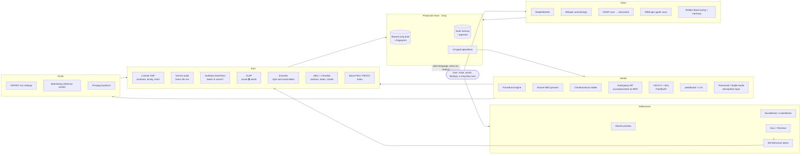

# Frank: Kiro use and technology review

Written 19 November 2026. This document answers two questions:

1. Does ChatGPT's assessment of how Frank uses Kiro hold up against the repository, and where can Kiro use improve?
2. Which technologies should be stitched into Frank so it becomes a true Frankenstein and a coherent product? This covers every technology ChatGPT listed, plus ones it missed because it could not see the code.

Ground rules used throughout:

- **Free to use** means it costs no money. A non-commercial licence is acceptable. Anything that needs payment, or a card on file, is flagged.
- **Ease is not a criterion.** Nothing below is ranked by how quickly it can be built before the deadline. It is ranked by what it does for the product and for the Frankenstein idea.
- **Evidence first.** Repo facts come from reading the code, specs, hooks and tests on 19 November (commit `64913e6`). Outside facts link to their source. Licences and quotas change, so each one is worth re-checking at integration time.

---

## Part 0. What Frank is today, in one page

The point of this section is to show what a reviewer who only reads the README misses.

| Area | What exists in code |
|---|---|
| Specs | 24 spec folders in `.kiro/specs/`, each with requirements, design and tasks in EARS form. About 200 requirements, about 424 ticked tasks, about 72 open (beat-room, export-room, kiro-craft, listener, song-engine, sound-quality, team-conversation, voice-room, voice-to-export-flow). `_roadmap.md` marks nothing as DONE, because the founder-listening rule says only the founder's ear can close a sound task. |
| Steering | 12 files. 10 are always included; `frank-team.md` and `producer-craft.md` are manual. None uses `fileMatch` or `auto`. |
| Hooks | 6 command hooks. Two run on Stop (architecture check, spec check). One runs on PreToolUse and blocks writes containing secrets or frontend audio processing (`scripts/guard_write.py`, exit 2). Three run on PostFileSave: plain-language check on `.tsx`, song property tests, and a background reference listen when engine files change. |
| Custom agents | 7: database-steward, frank-reviewer, integration-tester, listening-lab, pbt-author, plain-language-auditor, spec-keeper. Each runs on its own; none delegates to another. |
| MCP | Live config: context7, supabase, playwright. Frank also has its **own** MCP server, `tools/listener_mcp/server.py` (tools `measure_file`, `find_issues_file`, `compare_files`). It is listed in `mcp.json.example` but **not in the live config**. |
| Tests | 489 backend tests collected by pytest, of which about 240 are Hypothesis property tests (`@given`) across 24 files. No frontend tests and no fast-check. |
| CI | `.github/workflows/ci.yml` runs the spec check, the architecture check, backend pytest with the audio system libraries, and the frontend type-check and build. It does not run the plain-language check or `mutate_check`. |
| Ears (Listener) | `app/services/listener/`: K-weighted loudness (BS.1770), peak, clipping, noise floor, brightness, frequency bands, onsets, chroma and MFCC similarity, timing, cents off pitch. `findings.py` turns those numbers into 11 plain-language rules. Results are cached. |
| Production team | Refine loop with 2–3 directions (`services/refine/`), taste memory (`services/taste/`), creative-director identity, intention check, plain-language guard. All role cards go into one LLM call per message, because Groq's free tier allows about 6,000 tokens per minute. |
| Engine | Procedural composer (theory, styles.json with hand-written 16-step drums for 10 styles, lead and harmony), FluidSynth renderer with the MuseScore General SoundFont, pedalboard polish, 14 typed operations. |
| Voice | Hum to notes (pyin plus segmentation), rhythm tapping, tuning with Rubber Band, alignment, bleed removal, comping, chord-aware harmony, a guide vocal using the General MIDI "voice oohs" patch, engineer notes. |
| Mastering | pedalboard chain plus FFmpeg two-pass loudnorm to −14 LUFS. |
| LLMs | Groq `openai/gpt-oss-120b`, Gemini `gemini-flash-latest` as a text-only fallback, Groq Whisper for transcription (text only, no word timings). |
| Frontend | Next.js 14, React 18, Supabase, Zustand, Tailwind, Lucide. No Tone.js, even though `tech.md` lists it. No waveform library, rich-text editor, graph view or realtime channel. Jobs are polled. |

What is missing is just as telling. There are no audio embeddings, no general stem separation, no chord detection from audio, no syllable or rhyme analysis of lyrics, no LLM that hears audio, no way to bring in a reference song, and no public dataset anywhere in the product.

---

## Part 1. ChatGPT's assessment of Frank's Kiro use

### 1.1 Claim by claim

| ChatGPT said | What the repo shows | Verdict |
|---|---|---|
| Overall 7.8/10 | Close. My own figure is about 7.4 (see 1.2). The scores are in a reasonable range, but several are built on wrong facts. | Roughly right, for partly wrong reasons |
| "15 specs" | 24 spec folders, plus 9 original single-file specs kept in `_original-single-file-specs/`. | Wrong |
| Specs 8.5 | Real depth: EARS requirements, design docs, ticked tasks with evidence, a Spec Keeper agent and a Stop hook that checks spec drift. The weakness ChatGPT didn't see: 72 open tasks across 9 specs, and a roadmap where nothing is DONE. A judge may read that as unfinished unless the founder-listening rule is explained up front. | Fair; I'd give 9 |
| Steering 8 | 12 thorough files. Three problems: (a) 10 of them load into every prompt, which wastes context and dilutes the important rules; (b) no `fileMatch` or `auto` inclusion, the features that show you understand steering; (c) drift. `tech.md` still names Tone.js, which isn't installed, and `deployment.md` still lists `HUGGINGFACE_API_KEY` and `REPLICATE_API_TOKEN`, which the code no longer uses. | Slightly high; I'd give 7.5 |
| Hooks 8 | The hooks enforce rules for real. The PreToolUse guard actually blocks a write, which is rarer and stronger than "run lint on save". Gaps: no agent-type hooks, no spec-task hooks (`PreTaskExec` / `PostTaskExec`), and two checks that run in the IDE are missing from CI. | Fair; 8 |
| Agents 7.5 | Seven focused agents with clear jobs. None sets a model, none hands work to another, and there is no orchestrator. Kiro now documents sub-agent delegation ([Kiro docs: sub-agents](https://kiro.dev/docs/custom-agents/subagents/)), and community setups use a master orchestrator with specialist agents running in parallel ([example config](https://github.com/seandkendall/kiro-config)). | Fair; 7.5 |
| MCP 8.5, and "build an audio-analysis MCP" | That MCP **already exists** (`tools/listener_mcp`), and ChatGPT couldn't know. It is also **not switched on** in the live config, so in practice Kiro isn't using it. That is the single cheapest credibility gap in the project. | The recommendation is already built; the score should drop until it's wired in. 8 |
| "18 PBT" and PBT 7.5 | About 240 property tests and 489 tests in total. "18" comes from the stale `KIRO_USAGE.md` (line 154). There are no frontend property tests, and `mutate_check` (which proves tests can fail) isn't in CI. | Wrong count; I'd give 8.5 |
| Surfaces 5.5 (IDE only) | Correct. In 80 commits there is no trace of Kiro CLI, Kiro Web or Kiro Crew. | Right; I'd give 4 |
| Powers 2 | Correct. `~/.kiro/powers/installed.json` is empty and the repo has no `POWER.md`. | Right; 1.5 |
| Docs 7 | `KIRO_USAGE.md` is long (656 lines) and candid about failures, which is good. It is also stale ("18 tests", "three MCP servers"). The README uses the old room names and has no screenshots, video link or architecture diagram. | Slightly high; 6.5 |
| "Create a Frank Music Engineering Power" | Good idea, and Frank already has the parts: the listener MCP, `producer-craft.md` and `audio-architecture.md`. | Agree |
| "Use Kiro CLI / Web" | Agree, if each surface does a job the IDE can't (see 1.3). Using a surface just to tick a box would show. | Agree, with a condition |
| "Coordinate agents" | Agree. | Agree |
| "Document experiments" | Partly done already: `docs/demo-runs/` holds 3 recorded live demo runs, and `KIRO_USAGE.md` records failures. What's missing is a short, current summary a judge can read in two minutes. | Partly done |
| Innovation 6.5 | Fair for what a judge can *see*. Much of the engine's cleverness is invisible in the product and the README. The technology plan in Part 2 is aimed at this score. | Fair |

### 1.2 My scores

| Area | ChatGPT | Mine | Why mine differs |
|---|---|---|---|
| Specs | 8.5 | 9 | 24 specs, about 424 evidenced tasks, drift checked by a hook and an agent |
| Steering | 8 | 7.5 | No conditional inclusion; two files contradict the code |
| Hooks | 8 | 8 | Real blocking guard; no agent or spec-task hooks |
| Agents | 7.5 | 7.5 | Good specialists, no orchestration |
| MCP | 8.5 | 8 | Own MCP exists but is unplugged |
| PBT | 7.5 | 8.5 | About 240 properties, not 18; no frontend or mutation check in CI |
| Surfaces | 5.5 | 4 | IDE only |
| Powers | 2 | 1.5 | None |
| Docs | 7 | 6.5 | Candid but stale; README behind the product |
| **Overall** | **7.8** | **about 7.4** | |

### 1.3 Where Kiro use should improve

These are ordered by how strongly they show judges that Kiro was part of how Frank got built.

1. **Plug in the listener MCP, then make agents and hooks use it.** Add `frank-listener` to the live `.kiro/settings/mcp.json`. Give the Listening Lab agent and the Frank Code Reviewer the `measure_file` and `compare_files` tools, and record one session in `KIRO_USAGE.md` where Kiro listened to a render through the MCP and changed code because of it. That turns "we built an MCP" into "Kiro heard the music while writing the code".

2. **Package Frank's craft as a Power.** A Power is a folder with a `POWER.md` (front matter, onboarding, steering, workflows) and an `mcp.json`, and it can be added from a local path or imported from GitHub ([Kiro Powers overview](https://kiro.dev/docs/powers/); [a worked example of the folder layout](https://github.com/miroapp/miro-ai/blob/main/docs/kiro/power-development.md); [import from GitHub](https://github.com/verhasi/kiro-powers)). A `frank-sound-engineering` Power would contain:
   - `mcp.json` running `tools/listener_mcp/server.py`;
   - steering taken from `producer-craft.md` and the measurable parts of `audio-architecture.md`;
   - workflows such as "check a render before committing", "compare before and after an engine change" and "explain a finding in plain language".

   Publish it in the public repo so any Kiro user can import it. This is the strongest single answer to "Powers 2/10", because it is useful outside Frank.

3. **Move on-demand knowledge into Skills and conditional steering.** Kiro Skills are `SKILL.md` packages in `.kiro/skills/` that load only when relevant ([Kiro docs: skills](https://kiro.dev/docs/skills/)). The two manual steering files are natural Skills. Then:
   - give `audio-architecture.md` a `fileMatch` on `backend/app/services/**`;
   - give `design-and-ui.md` a `fileMatch` on `frontend/**`;
   - leave `product.md` always on.

   This cuts per-prompt context and shows each steering mechanism used for its real purpose.

4. **Add a producer orchestrator agent.** One agent that, for an engine change, calls Spec Keeper, then PBT Author, then Listening Lab, then Frank Code Reviewer, and stops if any of them objects. That is the player/coach pattern described for Kiro CLI sub-agents ([dev.to, AWS](https://dev.to/aws/implementing-playercoach-workflow-with-kiro-cli-subagents-2gf3)). It mirrors Frank's own idea of a production team: a team that builds the product, and a team inside the product.

5. **Give each surface a job only it can do.**
   - **Kiro CLI** runs the Kiro agent in a terminal ([Kiro docs: CLI](https://kiro.dev/docs/cli/)). Use it for a scripted "listening regression". It renders the 3 reference songs, calls the listener MCP, and writes a report. Run it from a terminal and commit the reports.
   - **Kiro Crew** is an open-source agent that runs on your own machine and supports background and scheduled work ([Kiro docs: Crew](https://kiro.dev/docs/crew/), [features](https://kiro.dev/docs/crew/features/)). Use it for a nightly job: pull the latest commit, run the listening regression, and post the findings. The 4 GB dev machine can run this because the heavy work is FFmpeg and FluidSynth, not models.
   - **Kiro Web**: no Frank-specific job beyond what the CLI covers. I would skip it rather than use it for show.

6. **Close the hook gaps.**
   - Add a `PostTaskExec` hook that runs that spec's property tests when a task is ticked.
   - Add an agent-type hook on saves to `backend/app/services/llm/prompts.py` that asks the Plain Language Auditor to review the change. Prompts are where jargon leaks into Frank's speech.
   - Add `check_plain_language.py` and `mutate_check` to CI, so the IDE and CI enforce the same rules.

7. **Add frontend property tests** with fast-check for the AudioEngine and the Arrangement grid state (for example: selecting and moving sections never loses a section; the active pointer always names an existing version).

8. **Fix steering drift and make it checkable.** Correct the Tone.js line and the stale environment variables. Then extend `scripts/check_specs.py`, or the Spec Keeper agent, to flag libraries named in steering that aren't in `package.json` or `requirements.txt`.

9. **Bring the docs up to date.** Correct the numbers in `KIRO_USAGE.md`, and add a 30-line summary at the top: "what Kiro did, what we built for Kiro (MCP, Power, hooks), what went wrong". Rename the rooms in the README and add the architecture diagram from Part 2.6, screenshots and the video link.

---

## Part 2. Technologies

### 2.1 The test every technology has to pass

The Frankenstein category asks for many technologies stitched into one creature. The risk is a pile of parts with no single body. Frank already has a spine that keeps it coherent: the LLM interprets, the shared song brief and the 14 typed operations carry decisions, and the engine executes. So a technology earns a place only if it does at least one of these:

1. **Gives Frank a sense it lacks.** Frank can currently measure sound but not *recognise* it. It knows loudness, not "this sounds like a late-night drive".
2. **Gives the engine better hands.** Patterns that feel played by humans rather than typed in, and instruments that sound recorded.
3. **Turns the user's voice into more song.** The voice-first path is Frank's reason to exist.
4. **Lets the user point at the world.** "Like this song" is how non-musicians talk.

It also has to respect the product rules. It never becomes a "generate song" button. Its output is either analysis, parameters the user can change, or an audio layer that can be undone. And it must cost nothing.

### 2.2 What ChatGPT recommended that Frank already has

ChatGPT couldn't read the code, so several of its ideas are already built:

| ChatGPT idea | Already in Frank |
|---|---|
| Audio-analysis MCP | `tools/listener_mcp` (not yet switched on) |
| Production memory | Taste memory, `services/taste/`, migration 009 |
| Offer a few directions, not one answer | Refine loop with 2–3 directions, `services/refine/` |
| Loudness-aware mastering | FFmpeg two-pass loudnorm to −14 LUFS after a pedalboard chain |
| Objective listening | Listener: BS.1770 loudness, peak, clipping, brightness, onsets, timing, cents off, 11 findings rules |
| Plugin-style effects | pedalboard 0.9.26 for polish and mastering |
| Pitch to notes | pyin plus Frank's own segmentation in `intake/melody.py` |

### 2.3 Verdict on every technology ChatGPT listed

"Integrate" means it belongs in the target product. "Concept" means borrow the idea but not the tool. "Reject" means it fails the cost or product test.

| Technology | Verdict | Licence and cost | What it does for Frank | Where it lives |
|---|---|---|---|---|
| **CLAP** (LAION) | **Integrate, central** | Code and `larger_clap_music*` weights permissive (Apache-2.0 per the model card); free. Int8 ONNX exports exist ([audio-compass ONNX](https://huggingface.co/DeafBoyAudio/audio-compass-models), [htsat-base ONNX](https://huggingface.co/muzaiten/clap-htsat-base-onnx)). | Puts sound and words in one shared space ([LAION-AI/CLAP](https://github.com/LAION-AI/CLAP)). Frank can score each texture against the user's own words ("late-night drive"), store taste as vectors, and offer "more like the one you liked". This is the sense Frank lacks most. | Feeling room ranking, taste memory, sample search |
| **Essentia** + MTG models | **Integrate, for labels** | Library AGPL-3.0. Models CC BY-NC-SA 4.0, so non-commercial, which is fine here ([MTG licence note](https://huggingface.co/Heyian/discogs-effnet-onnx)). ONNX conversions avoid TensorFlow. | Discogs-EffNet gives about 400 style labels, plus mood and danceability. Frank can check "does this render actually sound like the soul/lo-fi the brief asked for?" and tell the user in plain words. | Listener (a new "what it sounds like" finding), reference analysis |
| **Basic Pitch** | **Integrate; reverse the earlier rejection** | Apache-2.0, free. The old objection was TensorFlow at about 500 MB. Basic Pitch no longer installs TensorFlow by default and uses TFLite on Linux ([release notes](https://github.com/spotify/basic-pitch/releases)). The model is about 230 KB as ONNX ([npm port](https://classic.yarnpkg.com/en/package/@audio/neural-transcribe)). | Polyphonic notes with pitch bends. Better hum-to-notes on slides and vibrato. It can also transcribe the bass and melody of a reference song and turn a sung take into notes for harmony. Keep pyin as the fallback, and let the founder judge both by ear through the Listening Lab, as the 11 November decision required. | `intake/melody.py`, Voice room, reference analysis |
| **music21** | **Integrate, as a test oracle** | BSD-3, free. | An independent music-theory implementation. Use it in property tests to check `theory.py` (chord spelling, key estimates, voice leading) rather than as a runtime dependency. | `backend/tests` |
| **Demucs** | **Use a successor** | MIT, free, but upstream says it is no longer actively maintained ([facebookresearch/demucs](https://github.com/facebookresearch/demucs)). | Stem separation is needed (see BS-RoFormer in 2.4). Use Demucs only as a fallback model. | — |
| **ACE-Step 1.5** | **Concept, one narrow experiment** | Open weights (check the licence before use). Needs 12 GB or more of GPU memory for the XL model ([repo](https://github.com/ace-step/ACE-Step-1.5)). | It is a full-song generator, which is the opposite of Frank's promise. Its "lego" and "repaint" tasks, which add or redo one part inside existing audio ([model card](https://huggingface.co/ACE-Step/acestep-v15-xl-base)), are worth one blind ear test for adding a real-sounding guitar layer over Frank's beat. Keep it only if the founder can't tell it's AI. | Optional Music room layer |
| **Freesound** | **Integrate** | API free with a registered key ([API terms](https://freesound.org/help/tos_api/)). Filter to CC0 and CC BY sounds, and carry attribution into the export. | Real recorded atmospheres (rain, vinyl crackle, room tone, risers) and similarity search based on audio content ([API overview](https://freesound.org/docs/api/overview.html)). It makes textures feel like places instead of synth pads. | Feeling room textures, Music room "atmosphere" part |
| **Slakh2100** | **Integrate, offline** | CC BY 4.0, free. 2,100 tracks with aligned MIDI from 34 instrument classes ([slakh.com](https://slakh.com/)). | Mine it once to learn how real arrangements behave: which instruments play in which sections, how dense each part is, how parts enter and drop out. Write the results into the composer's style tables. | Engine calibration (run on Kaggle) |
| **MUSDB18** | **Evaluation only** | Research and non-commercial use. | A standard benchmark for testing bleed removal and separation quality. Not used in the product. | Tests |
| **Chartmetric** | Reject | Paid | — | — |
| **Soundcharts** | Reject | Paid | — | — |
| **MusicBrainz** | **Integrate, light** | Free, no key, 1 request per second ([rate limits](https://github.com/api-evangelist/musicbrainz)). | Clean artist and recording metadata, plus community genre tags, when the user names a reference song. | Reference lookup |
| **Exa** | **Integrate, for research** | Free tier of $10 credit a month with no card ([pricing summary](https://twitterapi.io/blog/exa-pricing)). | When the user says "like Frank Ocean's Nights", a research step finds how that record was produced (tempo shift, instruments, mood). The result goes into the brief as plain facts, never quoted lyrics. Also useful as a Kiro MCP while developing. | Creative director role |
| **Firecrawl** | **Integrate, paired with Exa** | Free plan with 500 searches or 1,000 pages, no card ([pricing](https://firecrawl.dev/pricing)). | Reads the pages Exa finds ([comparison](https://dev.to/ritza/firecrawl-vs-tavily-vs-exa-vs-deepseek-best-search-api-for-ai-agents-2026-27cc)). | Same |
| **Maschine "Ideas" view** | Concept, already absorbed | Paid product | The Arrangement grid in the Music room already works this way. | — |
| **Sononym** | Concept | Paid product | "Browse sounds by similarity". Build it with CLAP embeddings over Freesound and Frank's own parts. | Music room |
| **Web MIDI / MIDI 2.0** | **Concept for input; integrate MIDI export** | Free, but Web MIDI isn't in Safari. | Frank's user has no instrument, so MIDI input serves the wrong person. MIDI *export* serves the user who later takes the song to a real producer. Frank already builds MIDI internally. | Finish room "Download the notes" |
| **JUCE** | Reject | Free under the Starter tier or AGPL ([JUCE licensing](https://juce.com/get-juce/)) | A plugin framework. Frank runs in a browser and a Python server. | — |
| **Carla** | Reject | GPL, free | pedalboard can already load VST3 and LV2 plugins directly, so a separate plugin host isn't needed. | — |
| **iZotope RX** | Concept | Paid | The free replacement is DeepFilterNet (2.4). | — |
| **SoundID** | Concept | Paid | Idea worth keeping: a 20-second "check your headphones" moment in the Voice room. Frank already warns about headphones. | — |
| **FFmpeg loudnorm** | Already used | LGPL/GPL, free | — | — |
| **Tiptap** | **Integrate** | Core MIT, free | A lyric editor that can draw marks on the words: syllable counts per line, stressed syllables, rhyme families in matching colours. The analysis comes from the tools in 2.4. | Words room |
| **Yjs** | Concept until collaboration is a goal | MIT, free | Real-time co-editing. Only worth adding if two people write one song together. | — |
| **Liveblocks** | Reject | Free tier exists | Supabase Realtime, already in the stack, covers what Frank needs. | — |
| **DDEX RIN** | Concept | The standard needs an implementation licence | Borrow the idea of a session credit sheet: which parts were sung, which were built by which "organ", which samples need attribution. Ship it as a readable credits page, not as DDEX XML. | Finish room |
| **React Flow** | **Integrate** | MIT, free | Draws the song's version tree. Frank's rules promise branching and "never lose anything"; a visible family tree of versions makes that promise something a judge can see. | Song history view |
| **WaveSurfer.js** | **Integrate** | BSD-3, free | Waveforms with regions: comp segments in the Voice room, takes compared at the same position, scrubbing. The design rules ask for waveforms wherever audio exists. | Voice, Blend |
| **OpenAI Realtime** | Reject | Paid | The free path is in 2.4 (Kokoro for Frank's voice, browser speech input, Gemini). | — |
| **"Production memory"** | Already exists; extend | — | Store CLAP vectors next to each taste entry in Supabase pgvector, so memory matches by sound and not only by words. | Taste memory |

---

### 2.4 What ChatGPT missed

These come from my own research, aimed at the gaps in Part 0. They are grouped by the part of the creature they build.

#### Ears: Frank recognises what it hears, not only measures it

| Technology | Licence and cost | What it adds | Verdict |
|---|---|---|---|
| **Gemini audio input** | Free tier on the Gemini API, and Frank already has the key. Free-tier limits are per model and per day ([rate limits](https://ai.google.dev/gemini-api/docs/rate-limits)). Free-tier prompts may be used by Google to improve its products ([pricing notes](https://www.datastudios.org/post/google-ai-studio-pricing-free-access-usage-limits-api-costs-and-production-billing-in-early-2026)), so users must be told before their vocals are sent. | The mix engineer actually listens. Send a 20–30 second section bounce together with the Listener's numbers and ask for at most 3 plain-language notes. The numbers keep it honest: audio LLMs still score only around 50–60% on hard audio reasoning benchmarks ([MMAU-Pro](https://arxiv.org/html/2508.13992)). So Gemini *describes*, and the Listener *confirms* before Frank acts. | **Integrate.** It moves Gemini from text fallback to the ears of the team. |
| **Meta Audiobox Aesthetics** | Weights CC BY 4.0, free ([ONNX card](https://huggingface.co/Microck/audiobox-aesthetics-onnx), [repo](https://github.com/facebookresearch/audiobox-aesthetics)) | Scores audio on four axes: production quality, production complexity, content enjoyment and content usefulness ([summary](https://www.emergentmind.com/topics/meta-audiobox-aesthetics)). It is the missing "did this change make it better?" number for the refine loop, and a regression guard for the engine. It never replaces the founder's ear. | **Integrate.** Listener and refine loop. |
| **All-In-One structure analyzer (allin1)** | MIT, free ([all-in-one-infer](https://github.com/openmirlab/all-in-one-infer)) | Tempo, beats, downbeats and labelled sections (intro, verse, chorus, bridge) from audio ([paper](https://arxiv.org/pdf/2307.16425)). Frank knows the sections of its *own* beats by construction, but not of a reference song or an a cappella take. Voice-first needs this: "your chorus starts here." | **Integrate.** Reference analysis, Voice-first path. |
| **Chordino** via `chord-extractor` | GPL, free, CPU ([chord-extractor](https://github.com/ohollo/chord-extractor)) | Chords from audio. With it, Frank can learn the harmony of a reference song, or fit a beat under a song the user sings over a guitar recording. | **Integrate.** Reference analysis. |
| **PESTO** | Open source, lightweight and real-time ([paper](https://arxiv.org/html/2508.01488)) | A faster, sharper pitch tracker than pyin for the Voice room contour and tuning. | **Evaluate against pyin by ear.** |
| **Music Flamingo** (NVIDIA) | Non-commercial research licence ([model card](https://huggingface.co/nvidia/music-flamingo-hf)); free to use here. Too large for Render; needs a GPU Space. | An open audio-language model built for music, which handles up to 20 minutes of audio ([docs](https://huggingface.co/docs/transformers/model_doc/musicflamingo)). It is a second opinion beside Gemini that doesn't depend on Google's free tier. | **Optional.** Second ear on a GPU Space. |

#### Hands: the engine plays like people

| Technology | Licence and cost | What it adds | Verdict |
|---|---|---|---|
| **Groove MIDI Dataset** and E-GMD | CC BY 4.0, free. 13.6 hours and 1,150 files of real drummers, with velocity and timing ([GMD](https://magenta.withgoogle.com/datasets/groove), [E-GMD](https://magenta.withgoogle.com/datasets/e-gmd)) | Today the drums are hand-typed 16-step grids in `styles.json`. Real drummers' grooves bring the push, drag, ghost notes and velocity that make a beat feel played. Mine the files offline into per-style groove templates, then let typed operations such as "make the drums looser" choose among them. | **Integrate.** Biggest single sound gain for the least risk. |
| **Chordonomicon** | 666,000 songs' chord progressions with genre and section labels ([GitHub](https://github.com/spyroskantarelis/chordonomicon), [paper](https://arxiv.org/abs/2410.22046)). Scraped from user-made chord sites, so check the licence on the repo before use. | Turns the composer's progression choices from rules into real statistics: "what do soul choruses actually do after this chord?" Precompute small tables per genre and section; Frank still decides, the data only weights the choices. | **Integrate offline**, after a licence check. |
| **Anticipatory Music Transformer** | Apache-2.0, free ([code](https://github.com/jthickstun/anticipation)) | Given a melody, it suggests accompaniment and fills gaps, and it outputs **MIDI** ([Stanford CRFM](https://crfm.stanford.edu/2023/06/16/anticipatory-music-transformer.html)). That fits the spine: the user's hum becomes notes, the model proposes parts as MIDI, and Frank's engine renders and owns them. Every part can still be edited. | **Integrate**, running on a GPU Space or a small CPU model. |
| **VSCO-2 CE and VCSL** sample libraries | CC0, free ([VSCO-2 CE](https://versilian-studios.com/vsco-community/), [VCSL](https://github.com/sgossner/VCSL/blob/master/README.md)) | Real recorded strings, winds, keys and percussion, far richer than a General MIDI SoundFont. | **Integrate**, with sfizz. |
| **sfizz** | BSD-2, free; `sfizz_render` renders MIDI and SFZ offline ([example pipeline](https://huggingface.co/datasets/projectlosangeles/SFZ-Instruments)) | Plays SFZ instruments such as VSCO-2 beside FluidSynth. FluidSynth stays for General MIDI coverage; sfizz takes the instruments that matter most (piano, strings, keys). | **Integrate** in the renderer. |
| **Free LV2/VST3 effects through pedalboard** | LSP (LGPL), Dragonfly Reverb (GPL-3), all free ([LSP](https://github.com/sadko4u/lsp-plugins/blob/master/README.md), [Dragonfly](https://github.com/michaelwillis/dragonfly-reverb)) | Studio-grade rooms, compressors and EQs, loaded by the pedalboard Frank already uses. "Add space" becomes a real hall or plate. | **Integrate.** Install in the Dockerfile. |
| **Magenta RealTime 2** | Code Apache-2.0, weights CC BY 4.0 ([licence](https://huggingface.co/google/magenta-realtime-2/blob/main/README.md)). Built for live use, mainly on Apple Silicon or GPUs ([install notes](https://github.com/magenta/magenta-realtime/blob/main/docs/installation.md)). | A playable model that changes with text, MIDI and audio prompts in real time. In Feeling, the user could steer a texture live ("warmer… slower… there") instead of waiting for 10-second renders. | **Optional.** Strong, but needs hardware Frank doesn't have for free. |
| **Stable Audio 3 Small** | Stability Community Licence, free under $1M revenue ([licence explainer](https://stability.ai/explainers/self-hosted-vs-api-generative-audio-choosing-a-deployment-model)) | Short sounds and ambiences from text. Use it only as one removable texture layer ("the sound of a city at night"), never as the song. | **Optional.** Feeling textures. |

#### Voice: the user's voice turns into more of the song

| Technology | Licence and cost | What it adds | Verdict |
|---|---|---|---|
| **DDSP timbre transfer** (Magenta) | Apache-2.0, free ([demos](https://github.com/magenta/ddsp/blob/master/ddsp/colab/demos/README.md)) | Turns a hummed line into violin, flute or trumpet, keeping the user's own phrasing and expression. "Your hum *is* the solo" is the most Frankenstein moment available: the user's body grafted onto an instrument. | **Integrate.** Voice and Music rooms; runs on a GPU Space, small enough for CPU tests. |
| **DiffSinger** through OpenUtau voicebanks | Open source; each voicebank has its own licence ([OpenUtau DiffSinger support](https://openutau.com/DiffSinger-support/)) | A guide vocal that actually sings the user's lyrics on the melody, instead of the current "voice oohs" patch. The user hears how the line goes, then records it themselves. It is a guide only, never the final vocal. | **Integrate.** Pick an English voicebank whose licence allows this use. |
| **DeepFilterNet 3** | MIT/Apache, free. Real-time on one CPU core ([paper](https://arxiv.org/html/2305.08227v1), [repo](https://github.com/Rikorose/DeepFilterNet)) | Removes fans, hiss, traffic and room noise from phone and laptop recordings. Frank's user records in a bedroom, so this matters more than any effect. | **Integrate.** Voice room, before tuning. Fits Render's CPU. |
| **Groq Whisper word timestamps** | Already on the free tier ([Groq: word-level timestamps](https://groq.com/blog/build-fast-with-word-level-timestamping)) | Each lyric word gets a time in the take. Then "redo the second line", punch-ins, and comping by line all become possible, and the Words room can highlight the line that's playing. | **Integrate.** Small change to existing code. |
| **Kokoro TTS** | Apache-2.0, 82M parameters, runs on CPU ([model card](https://huggingface.co/MaziyarPanahi/Kokoro-82M)) | Frank can *speak* its notes ("the chorus feels stronger now, have a listen"). The user may have a mic in hand and eyes closed. | **Integrate**, optional to switch on. |

#### Words: lyrics with an ear for rhythm

| Technology | Licence and cost | What it adds | Verdict |
|---|---|---|---|
| **CMU Pronouncing Dictionary** with `pronouncing` | Permissive, free, runs locally | Syllable counts, stress patterns and rhymes, without any network call. Frank can say "this line has two more beats than the one before it" and show it in the Tiptap editor. | **Integrate.** Words room. |
| **Datamuse API** | Free. From 1 February 2027 it needs a free key and allows 100,000 requests a day ([Datamuse](https://datamuse.com/api/)) | Near rhymes, "means like" and sound-alike words for the co-writer. | **Integrate**, with the CMU dictionary as the offline fallback. |

#### Pointing at the world: "make it feel like this song"

| Technology | Licence and cost | What it adds | Verdict |
|---|---|---|---|
| **Deezer public API** | Free, no key; 30-second previews ([example use](https://github.com/mbadr3227-sys/jammming)) | The user types a song name, and Frank fetches a legal 30-second preview. That preview feeds the ears above (CLAP, Essentia, allin1, Chordino, Basic Pitch) to extract a target fingerprint. The song itself is never stored or reused. | **Integrate.** This is the doorway for every reference feature. |
| **AcoustID** | Free for non-commercial use, 3 requests a second ([AcoustID](https://acoustid.org/)) | Identifies a song the user uploads or plays. | Optional |
| **ListenBrainz / Wikidata** | Free, open data | "Similar artists" and genre relations, so Frank can explain a reference in words the user knows. | Optional |
| **Matchering 2** | GPL-3.0, free, CPU ([README](https://github.com/sergree/matchering/blob/master/README.md)) | Masters Frank's song to match a reference song's loudness, tone balance, peak level and stereo width ([description](https://mefmobile.org/apps/matchering/)). "Make it sound as finished as that song." | **Integrate.** Finish room, as an alternative master the user compares against Frank's own. |
| **Diff-MST** | Open source research code ([repo](https://github.com/sai-soum/Diff-MST)) | Predicts **mixing console settings** from the raw parts and a reference song ([paper](https://arxiv.org/html/2407.08889v1)). The output is parameters rather than audio, which is exactly Frank's rule: the result lands in `mix_params`, and the user can still say "the vocal's too loud". | **Integrate.** Blend room, behind a GPU Space. |
| **BS-RoFormer** through `audio-separator` | Open source, free; a GPU Space is needed for speed ([2026 benchmark](https://dev.to/codesugar_lin_037a57b06a4/htdemucs-vs-bs-roformer-vs-spleeter-a-2026-audio-source-separation-benchmark-2ll8)) | Splits a reference preview into vocals, drums, bass and other, so the other ears can analyse each part. It also gives a stronger bleed removal path when the user records without headphones. | **Integrate.** Reference analysis, Voice room. |

#### Memory and nervous system

| Technology | Licence and cost | What it adds | Verdict |
|---|---|---|---|
| **Supabase pgvector** | Included in Supabase, free | Stores CLAP vectors for textures, parts, reference songs and taste entries. Memory then works by sound ("closer to the one from Tuesday"). | **Integrate** |
| **Supabase Realtime** | Included, free | Replaces 2-second polling. Job progress and Frank's notes arrive as they happen, and the Arrangement grid can update live while a part renders. | **Integrate** |

#### Public datasets for mapping feelings to sound

The Innovation criterion explicitly rewards public datasets. These let Frank learn how *people* describe music, instead of relying on the LLM's guesses alone.

| Dataset | Licence | Use |
|---|---|---|
| **Song Describer** | CC-licensed recordings with 1,100 human captions ([GitHub](https://github.com/mulab-mir/song-describer-dataset)) | Embed the captions and audio with CLAP, then fit how words like "dreamy" or "punchy" map onto the fingerprint axes (brightness, energy, density, warmth). It becomes a measured translation table instead of a prompt. |
| **MusicCaps** | Captions CC BY-SA 4.0; audio is on YouTube ([card](https://huggingface.co/datasets/google/MusicCaps/blob/main/README.md)) | More caption data for the same mapping. |
| **MTG-Jamendo** (moods) | Creative Commons per track | Mood labels on real tracks, to check that "melancholic" renders land near melancholic music. |
| **DEAM** | Research use; check terms | Valence and arousal over time, to calibrate energy and mood curves across sections. |
| Groove MIDI, Slakh, Chordonomicon | See above | Hands and arrangement. |

---

### 2.5 Running the neural parts for free

Render's free web service has about 512 MB of memory, so it can't hold PyTorch models. A four-tier plan keeps everything free:

| Tier | Where | What runs there | Notes |
|---|---|---|---|
| 1. On Render, CPU | The existing Docker service | Small ONNX models: Basic Pitch (about 230 KB), DeepFilterNet 3, and possibly int8 CLAP. Plus the CPU tools: Chordino, Matchering, sfizz, LV2 effects, the CMU dictionary. | Load models lazily and one at a time. Measure memory before adding CLAP here. |
| 2. Free hosted APIs | Gemini, Groq, Deezer, MusicBrainz, Freesound, Datamuse, Exa, Firecrawl | Listening notes, word timings, references, samples, rhymes, research | All have free tiers; Gemini needs the privacy notice. |
| 3. Hugging Face ZeroGPU Spaces | Frank's own Spaces, called with `gradio_client` | allin1, BS-RoFormer, DDSP, Anticipatory Music Transformer, Diff-MST, Audiobox Aesthetics, Music Flamingo | Free accounts can host up to 2 ZeroGPU Spaces, if the account is verified and older than about 30 days ([HF Spaces overview](https://huggingface.co/docs/hub/en/spaces-overview)). GPU time is a small daily quota ([guide](https://www.itechguides.com/how-to-use-hugging-face-hub-spaces-and-apis-including-free-gpu-limits/)). With only 2 Spaces, bundle the models into two: "Frank's ears" (analysis) and "Frank's hands" (generation). Treat them as asynchronous jobs that may be slow, and keep a CPU fallback for every path. |
| 4. Kaggle notebooks, offline | Kaggle (keys are already in `backend/.env`) | One-off mining: Groove MIDI to groove templates, Slakh to arrangement statistics, Chordonomicon to progression tables, Song Describer to the feeling-to-fingerprint table | Results are committed as small JSON files. Nothing runs at request time. |

**Modal is not free under Frank's rules.** Its Starter plan includes $30 of monthly credit, but Modal requires a payment method on file ([Modal billing docs](https://modal.com/docs/guide/billing)). Since `deployment.md` says no card anywhere, Modal is excluded unless you choose otherwise.

### 2.6 The target creature

Each new technology attaches to Frank's existing spine. None of them talks to the user directly. All of them report to the team, and the team speaks in plain language.

The loop that makes it one creature is **hear → decide → change → hear again**. Every change Frank makes is followed by the ears checking the result, and Frank reports whether the change helped. The Listener and Audiobox give the numbers; Gemini gives the words. This is the "two-way production" promise turned into something measurable.

Three rules keep it coherent as the parts grow:

1. **Every organ reports to the brief.** Analysis results go into the shared song brief or the fingerprint. Generators produce MIDI or parameters wherever they can (Anticipatory MT, Diff-MST, Groove templates). Where they produce audio (DDSP, DiffSinger, Stable Audio, Freesound), the result is one named, removable layer.
2. **Every organ shows its work in plain language.** Frank already marks actions with "► Beat adjusted". Add where the help came from: "► Drums: from a real drummer's groove", "► Master matched to the song you picked". The stitching becomes visible in the product, which is what a Frankenstein judge looks for. Keep the wording free of jargon, so the Plain Language Auditor and `check_plain_language.py` cover it.
3. **Nothing is final.** Each organ's output is versioned like the rest of Frank, compared side by side, and undoable.

This direction also has outside support. A 2026 paper describes an LLM that writes readable settings for a procedural sound engine instead of generating waveforms, for the same reason Frank does: fine control by the person ([arXiv 2607.00309](https://arxiv.org/html/2607.00309)). It is worth citing in the write-up as independent support for Frank's core design.

### 2.7 Moments the stitching makes possible

These show the creature working, in the Path A and Path B flows the product already promises.

1. **The hum becomes a band.** The user hums. Basic Pitch turns it into notes, and DDSP turns the same hum into a cello that keeps their phrasing. The Anticipatory Music Transformer proposes accompaniment around it as MIDI. The drums come from a real drummer's groove. Frank plays the result and asks how it feels.
2. **"Make it feel like this song."** The user names a song. Deezer fetches the preview, and BS-RoFormer splits it into parts. allin1, Chordino, CLAP and Essentia describe what the song does. Frank explains the difference in plain words ("theirs is slower and the drums sit further back") and offers 2–3 directions. Matchering offers a master that matches the reference.
3. **Frank listens before it speaks.** The user says "something feels off". Gemini hears the section, the Listener confirms it with numbers, and Frank makes at most 2–3 changes. Then it listens again and reports whether the Audiobox score went up.
4. **From bedroom phone to clean take.** DiffSinger sings a guide of the user's lyrics. The user records on a laptop mic, and DeepFilterNet removes the fan noise. Whisper word timings let them say "redo the second line", and Frank comps it in.

### 2.8 Licences to manage

- **Frank is MIT.** Adding GPL tools (Matchering, Chordino, Dragonfly) or AGPL tools (Essentia, and Strudel if used) to the backend means the combined server is effectively under GPL or AGPL terms. Frank's source is already public, so meeting those terms is realistic. Either relicense the backend as AGPL-3.0, which is still an open-source licence and so still meets the hackathon rule, or run the copyleft tools as separate processes. This is not legal advice; decide it deliberately before integrating.
- **Non-commercial weights** (Essentia models, Music Flamingo, AcoustID, MUSDB18, possibly DEAM) are fine under your rule. List them in a `THIRD_PARTY.md`, so nobody later assumes Frank can be sold as is.
- **Attribution** is required by CC BY sources (Groove MIDI, Slakh, Audiobox weights, Magenta RT weights, Freesound CC BY sounds). The Finish room credits page from 2.3 is the natural place for it.
- **Reference previews** are analysed and then discarded, never stored or mixed in. Say so in the UI.

### 2.9 Considered and rejected

| Technology | Why not |
|---|---|
| YuE, DiffRhythm, Suno-style full-song models | They turn Frank into the song generator its product rules forbid. |
| Strudel / TidalCycles in the product | AGPL, and code-based pattern writing serves musicians rather than Frank's user. Its mini-notation is worth borrowing as an idea for compact pattern storage ([licence note](https://strudel.cc/technical-manual/project-start/)). |
| OpenAI Realtime, iZotope RX, SoundID, Chartmetric, Soundcharts, Splice | Paid. |
| Modal | Needs a card on file (see 2.5). |
| Spleeter | Superseded on quality by BS-RoFormer and htdemucs. |
| Web MIDI input | Serves people who own instruments; Frank's user doesn't. |

---

## Part 3. Decisions for you

1. **Licence direction.** Relicense the backend as AGPL-3.0 to allow GPL and AGPL tools in-process, or keep MIT and isolate those tools?
2. **Gemini privacy.** Is a one-time notice ("Frank sends short clips to Google to listen to your mix") acceptable, or should Gemini listen only to Frank's own beats and never to vocals?
3. **Hugging Face account.** ZeroGPU hosting needs an account older than about 30 days. Does the account behind `HF_TOKEN` qualify?
4. **ACE-Step blind test.** Do you want the single "one extra layer" ear test, or should it be ruled out on principle?
5. **Test account.** Still open from the redesign: should I delete `frank-design-test@example.com` and its 2 songs?

---

*Sources are linked inline. Quoted material is limited to short phrases, and the rest is paraphrased; content was rephrased for compliance with licensing restrictions. Licences, quotas and model availability change often, so re-check each one when integrating.*
